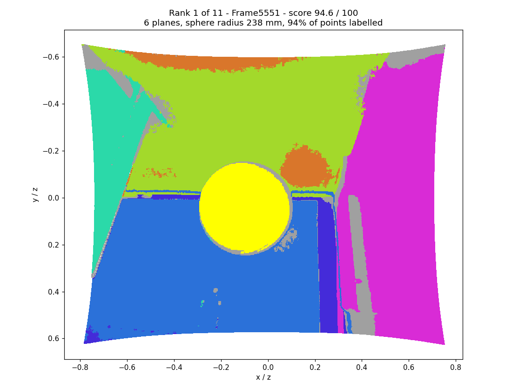
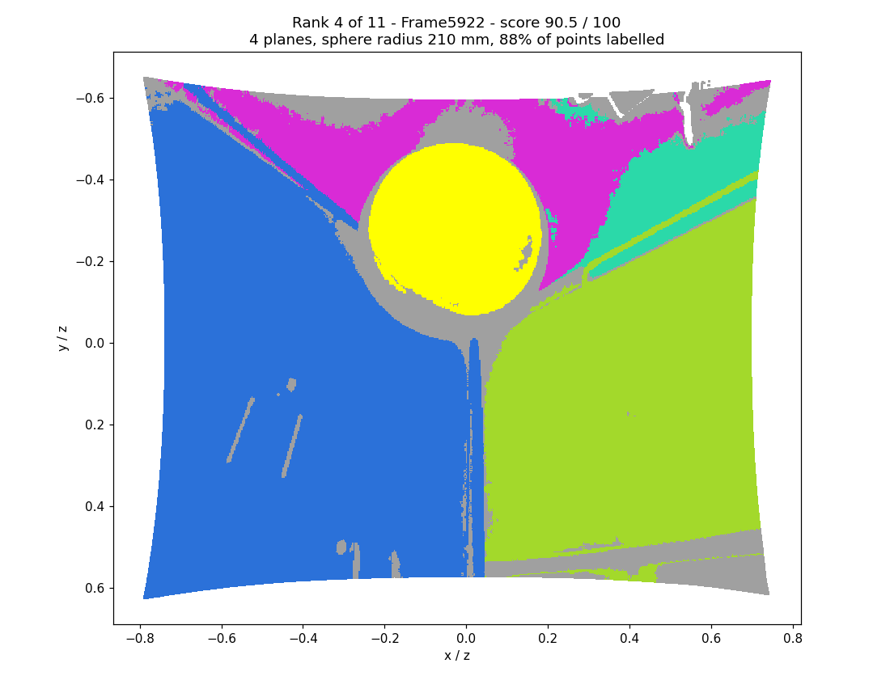
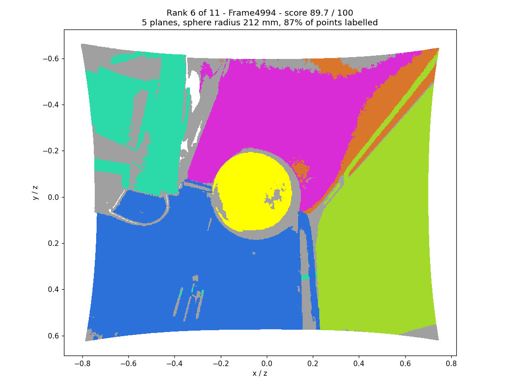
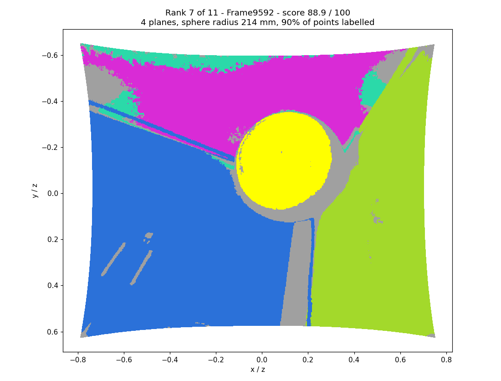
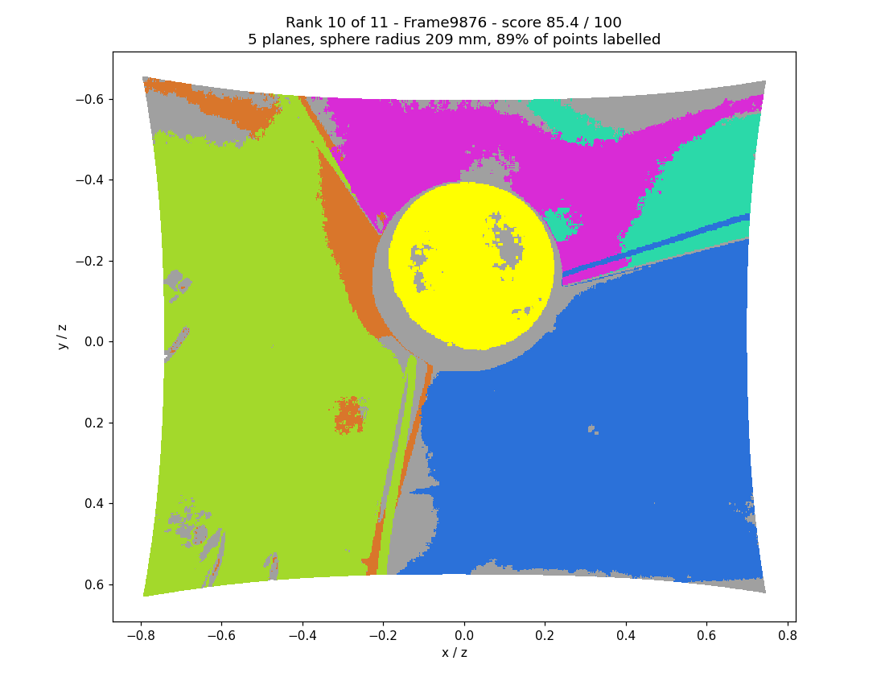
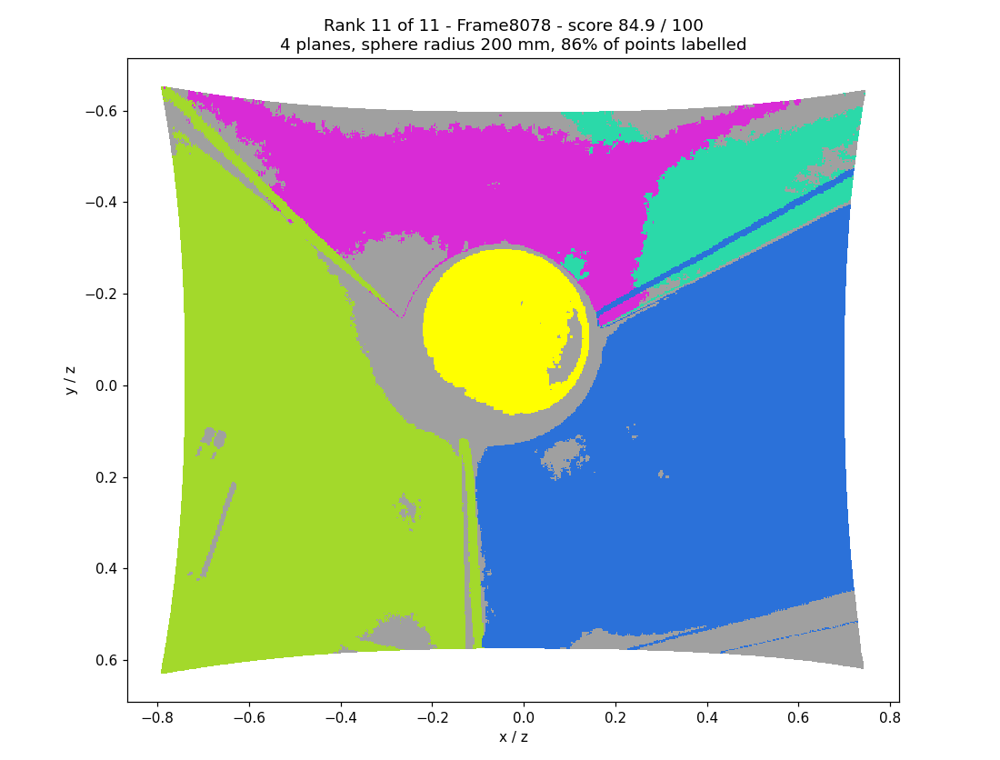

# 3D Point Cloud Segmentation: Sphere and Multi-Plane Extraction

[](https://www.elte.hu)
[](https://www.python.org/)
[](#critical-constraints--rules)
[](#)

A fully automated, from-scratch 3D point cloud segmentation pipeline for RGB-D camera captures. The system parses ASCII `.pcd` point clouds, adaptively calculates sensor noise characteristics, detects and reconstructs **exactly one sphere**, extracts an **arbitrary number of distinct planar surfaces**, and exports the resulting color-coded point cloud as an ASCII `.ply` file.

All geometric algorithms—including the custom PCD/PLY parsers, RANSAC model estimators, spatial covariance solvers, and least-squares refiners—are implemented strictly using **NumPy** and standard Python libraries without relying on specialized 3D geometry packages.

---

## Visual Results Gallery

Below are sample segmentation results generated by the pipeline across different frames. The resulting point clouds are rendered to illustrate the extracted geometric primitives:
- **Sphere:** Highlighted in bright **Yellow** (`RGB: 255, 255, 0`).
- **Planes:** Segmented into distinct surfaces, each assigned a high-contrast hue generated via golden-ratio HSV distribution.
- **Unclassified / Outliers:** Marked in neutral **Grey** (`RGB: 160, 160, 160`).

| Frame 5551 (6 Planes + Sphere) | Frame 5922 (4 Planes + Sphere) |
| :---: | :---: |
|  |  |
| *Estimated Sphere Radius: 238.9 mm &bull; 6 Segmented Planes* | *Estimated Sphere Radius: 209.8 mm &bull; 4 Segmented Planes* |

| Frame 4994 (5 Planes + Sphere) | Frame 9592 (4 Planes + Sphere) |
| :---: | :---: |
|  |  |
| *Estimated Sphere Radius: 212.2 mm &bull; 5 Segmented Planes* | *Estimated Sphere Radius: 214.3 mm &bull; 4 Segmented Planes* |

| Frame 9876 (5 Planes + Sphere) | Frame 8078 (4 Planes + Sphere) |
| :---: | :---: |
|  |  |
| *Estimated Sphere Radius: 210.2 mm &bull; 5 Segmented Planes* | *Estimated Sphere Radius: 200.5 mm &bull; 4 Segmented Planes* |

> [!NOTE]
> High-resolution ASCII `.ply` models corresponding to all 11 frames and their rendered `.png` previews are available in the [`results/`](results/) folder.

---

## Benchmark & Quantitative Summary

The table below summarizes the quantitative segmentation results across all 11 provided PCD frames:

| Frame Name | Total Valid Points | Estimated Noise $\sigma$ (MAD) | Sphere Radius $R$ | Sphere Inliers | Planes Detected | Result Artifacts |
| :--- | :---: | :---: | :---: | :---: | :---: | :--- |
| `Frame4994.pcd`  | 215,659 | 1.42 mm | 212.2 mm | 10,652 | 5 | [PLY](results/06_Frame4994.ply) &bull; [PNG](results/06_Frame4994.png) |
| `Frame5551.pcd`  | 217,056 | 1.50 mm | 238.9 mm | 14,738 | 6 | [PLY](results/01_Frame5551.ply) &bull; [PNG](results/01_Frame5551.png) |
| `Frame5922.pcd`  | 217,028 | 1.29 mm | 209.8 mm | 17,551 | 4 | [PLY](results/04_Frame5922.ply) &bull; [PNG](results/04_Frame5922.png) |
| `Frame7183.pcd`  | 217,009 | 1.36 mm | 201.5 mm | 10,946 | 5 | [PLY](results/08_Frame7183.ply) &bull; [PNG](results/08_Frame7183.png) |
| `Frame7735.pcd`  | 217,073 | 1.26 mm | 231.6 mm | 14,324 | 5 | [PLY](results/05_Frame7735.ply) &bull; [PNG](results/05_Frame7735.png) |
| `Frame8078.pcd`  | 217,088 | 1.09 mm | 200.5 mm | 11,997 | 4 | [PLY](results/11_Frame8078.ply) &bull; [PNG](results/11_Frame8078.png) |
| `Frame9387.pcd`  | 217,088 | 1.29 mm | 203.6 mm | 14,908 | 4 | [PLY](results/09_Frame9387.ply) &bull; [PNG](results/09_Frame9387.png) |
| `Frame9592.pcd`  | 217,088 | 1.34 mm | 214.3 mm | 17,161 | 4 | [PLY](results/07_Frame9592.ply) &bull; [PNG](results/07_Frame9592.png) |
| `Frame9876.pcd`  | 217,080 | 1.05 mm | 210.2 mm | 14,821 | 5 | [PLY](results/10_Frame9876.ply) &bull; [PNG](results/10_Frame9876.png) |
| `Frame15439.pcd` | 217,043 | 1.54 mm | 224.2 mm | 19,505 | 4 | [PLY](results/03_Frame15439.ply) &bull; [PNG](results/03_Frame15439.png) |
| `Frame18031.pcd` | 216,702 | 1.49 mm | 211.2 mm | 16,057 | 5 | [PLY](results/02_Frame18031.ply) &bull; [PNG](results/02_Frame18031.png) |

---

## Critical Constraints & Rules

1. **No 3D Geometry Libraries:** External point cloud or mesh libraries (e.g., Open3D, PCL, Trimesh, CGAL) are **strictly forbidden**. Only NumPy, Python standard library, and OpenCV (solely for auxiliary 2D image previews in the research notebook) are permitted.
2. **From-Scratch Algorithmic Implementation:** All point-to-plane distance metrics, sphere circumcenter equations, RANSAC loops, covariance analysis, least-squares refits, and file parsers are written by hand.
3. **Strict Color Compliance:**
   - Sphere inliers: **Yellow** (`RGB: 255, 255, 0`).
   - Planar inliers: **Distinct colors per individual plane**.
   - Outliers / unassigned points: **Neutral grey** (`RGB: 160, 160, 160`).
4. **Command-Line Interface:** Fully automatic operation accepting exactly two positional arguments: `<input_file.pcd>` and `<output_file.ply>`.

---

## Algorithmic Architecture & Methodology

```
┌────────────────────────┐
│     ASCII PCD File     │
└───────────┬────────────┘
            │ 1. Parse & filter invalid points (z <= 0, NaN, Inf)
            ▼
┌────────────────────────┐
│  Valid Point Cloud P   │
└───────────┬────────────┘
            │ 2. Local patch PCA & Median Absolute Deviation (MAD)
            ▼
┌────────────────────────┐
│ Adaptive Tolerances    │ ───►  Plane Tol = 10 * sigma, Sphere Tol = 3.5 * sigma
└───────────┬────────────┘
            │ 3. Constrained Anchor RANSAC + Visibility Test + Refit
            ▼
┌────────────────────────┐
│ Sphere Extraction      │ ───►  Mark Sphere points Yellow (255, 255, 0)
└───────────┬────────────┘
            │ 4. Exclude sphere inliers from remaining cloud
            ▼
┌────────────────────────┐
│ Sequential Plane RANSAC│ ───►  Extract planes iteratively until count < min_fraction
└───────────┬────────────┘
            │ 5. Covariance PCA Refinement & Golden-Ratio Color Paletting
            ▼
┌────────────────────────┐
│ Colored Point Cloud    │
└───────────┬────────────┘
            │ 6. Fast ASCII Serializer
            ▼
┌────────────────────────┐
│     ASCII PLY File     │
└────────────────────────┘
```

### 1. Robust PCD Input Parser
- Parses ASCII `.pcd` headers dynamically according to `FIELDS` and `COUNT` keywords to locate `x`, `y`, `z` columns regardless of additional fields (e.g., intensity, normals, RGB).
- Discards non-finite coordinates (`NaN`, `Inf`) and invalid depth returns (`z <= 0`).

### 2. Adaptive Surface Noise Estimation
Rather than relying on brittle, hand-tuned distance thresholds, the algorithm estimates the physical sensor noise directly from local surface patches:
1. Samples representative anchor points and finds their $k$-nearest neighbors ($k=40$).
2. Computes the local covariance matrix:
   $$\mathbf{C} = \sum (p_i - \bar{p})(p_i - \bar{p})^T$$
3. Solves for the principal normal $\mathbf{n}$ corresponding to the minimum eigenvalue of $\mathbf{C}$.
4. Computes residuals $r_i = p_i \cdot \mathbf{n} - d$ and computes the **Median Absolute Deviation (MAD)**:
   $$\sigma = 1.4826 \times \text{median}\left(|r_i - \text{median}(r)|\right)$$
5. Sets scene-adaptive tolerances:
   $$\tau_{\text{sphere}} = 3.5 \times \sigma, \quad \tau_{\text{plane}} = 10.0 \times \sigma$$

### 3. Constrained Sphere Detection & Refinement
1. **Minimal 4-Point Solver:** Solves the linear system formed by 4 non-coplanar points:
   $$2(p_i - p_0) \cdot (c - p_0) = \|p_i - p_0\|^2 \quad \text{for } i \in \{1, 2, 3\}$$
2. **Anchor-Based Spatial Sampling:** Instead of sampling 4 random points across the entire scene (which has near-zero probability of landing on a single sphere), points are sampled from a localized spatial ball around an anchor point.
3. **Visibility Verification:** Discards points on the occluded back side of the sphere by checking camera line-of-sight:
   $$(p_i - c) \cdot p_i \le 0$$
4. **Least-Squares Algebraic Refinement:** Uses the pseudo-inverse on all candidate inliers to solve for the optimal center $c$ and radius $R$:
   $$[\mathbf{1}, -2\mathbf{X}, -2\mathbf{Y}, -2\mathbf{Z}] \begin{bmatrix} \|c\|^2 - R^2 \\ c \end{bmatrix} = -\|p\|^2$$
5. **Priority Masking:** Sphere points are labeled first and masked out so that planar surfaces intersecting the sphere boundary do not cannibalize sphere points.

### 4. Sequential Multi-Plane Extraction
1. **3-Point Minimal Sample:** Selects 3 points and computes normal $\mathbf{n} = \frac{(b-a)\times(c-a)}{\|(b-a)\times(c-a)\|}$ with a non-collinearity threshold.
2. **Inlier Evaluation:** Evaluates absolute perpendicular distance $|p_i \cdot \mathbf{n} - d| \le \tau_{\text{plane}}$.
3. **Least-Squares Plane Refit:** Uses PCA on inliers (eigenvector of the centered covariance matrix with smallest eigenvalue) to refine $\mathbf{n}$ and $d = \mathbf{n} \cdot \bar{p}$.
4. **Greedy Iteration:** Removes detected inliers from the active point pool and repeats until remaining candidate clusters fall below the minimum support threshold ($\ge 3\%$ of the point cloud).

### 5. Color Mapping & ASCII PLY Serialization
- Sphere points receive RGB `(255, 255, 0)`.
- Planes receive distinct, maximally separated hues using the golden-ratio progression:
  $$H_k = (0.6 + 0.618 \times k) \pmod 1, \quad S = 0.80, \quad V = 0.85$$
- Unclassified points receive neutral grey `(160, 160, 160)`.
- Writes standard ASCII `.ply` format with high floating-point precision.

---

## Directory Layout

```text
FIRST_ASSIGNMENT/
├── Assignment.ipynb       # Research notebook with experiments & OpenCV projections
├── main.py                # Standalone CLI point cloud segmentation tool
├── README.md              # Project documentation with visual results
├── requirements.txt       # Dependencies (NumPy, OpenCV)
├── request.md             # Official assignment requirements and criteria
├── ai_prompts.md          # Log of GenAI prompts and workflow documentation
├── results/               # Generated output point clouds and rendered images
│   ├── 01_Frame5551.ply   # Segmented ASCII PLY model
│   ├── 01_Frame5551.png   # Rendered preview
│   ├── 02_Frame18031.ply
│   ├── 02_Frame18031.png
│   ├── ...
│   ├── 11_Frame8078.ply
│   └── 11_Frame8078.png
├── Frame4994.pcd          # Input depth sensor point cloud frames (ASCII PCD)
├── Frame5551.pcd
├── Frame5922.pcd
├── Frame7183.pcd
├── Frame7735.pcd
├── Frame8078.pcd
├── Frame9387.pcd
├── Frame9592.pcd
├── Frame9876.pcd
├── Frame15439.pcd
└── Frame18031.pcd
```

---

## Installation & Setup

Ensure Python 3.8+ is installed. Inside the `FIRST_ASSIGNMENT` folder, install the required packages:

```bash
pip install -r requirements.txt
```

### Dependencies
- `numpy`: Core vector/matrix math, eigen-solvers, linear algebra.
- `opencv-python`: Auxiliary image rendering in `Assignment.ipynb` (not required for `main.py`).

---

## Usage Instructions

Run the application from the command line with exactly two positional arguments:

```bash
python main.py <input_file.pcd> <output_file.ply>
```

### Example Commands

```bash
# Segment Frame 5551
python main.py Frame5551.pcd Frame5551_result.ply

# Segment Frame 5922
python main.py Frame5922.pcd Frame5922_result.ply

# Segment Frame 4994
python main.py Frame4994.pcd Frame4994_result.ply
```

### Console Output Example
```text
Saved 217,056 points. Plane tolerance 15.02 mm, sphere tolerance 5.26 mm.
```

The resulting `.ply` file can be directly inspected in any point cloud viewer such as **CloudCompare**, **MeshLab**, or **Blender**.

---

## Design Advantages & Engineering Trade-Offs

### Key Strengths
- **Fully Autonomous:** Operates completely without manual threshold tuning across varied scenes.
- **Strict Compliance:** Zero external 3D libraries; complies with all strict assignment constraints.
- **Reproducible:** Uses deterministically seeded random number generation for consistent evaluations.
- **Two-Stage Refinement:** Combines sample-based minimal RANSAC proposals with analytical least-squares fitting over full inlier sets.

### Known Trade-offs & Limitations
- **Coplanar Patches:** Since planes are extracted based on infinite geometric plane equations $p \cdot \mathbf{n} = d$, two physically disconnected surfaces lying on the same geometric plane will receive the same label. Adding Euclidean clustering / connected components would separate them but introduces additional spatial indexing overhead.
- **RANSAC Iteration Cap:** Sphere detection relies on 800 trials and planes on 350 trials; scenes with severe occlusion or high clutter may require higher trial counts.
- **ASCII I/O:** ASCII format is human-readable and standard for this assignment, though slower than binary PCD/PLY formats for point clouds exceeding 1M points.
